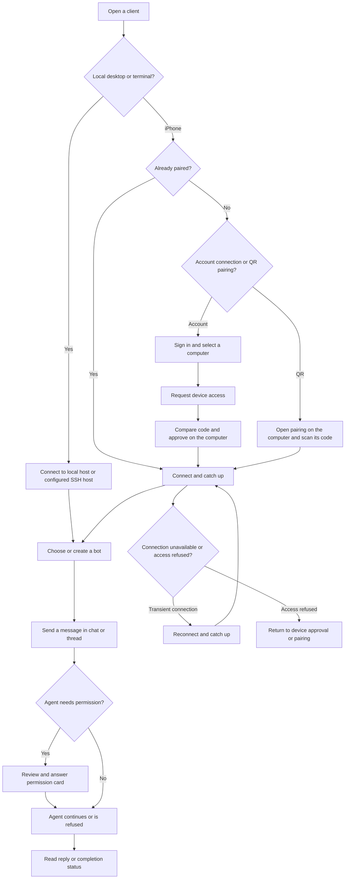

# App flow

Draft of implemented journeys, grounded in the [account guide](guides/accounts-and-ssh.md), [remote protocol](reference/remote-relay.md) and [UI conventions](design/ui-conventions.md). This is a user journey diagram, not a network topology or proof of production availability.

## Main journey

The local/SSH connection split is from [architecture](architecture/overview.md). QR and account authorization are separate flows in [protocol sections 4.1 and 4.2](reference/remote-relay.md). Permission routing and thread behavior come from [groups and threads](features/groups-and-threads.md).

## Account and computer access

1. Sign in through the platform account UI. The account guide describes browser cancellation, retryable network errors and session restoration; enabled MFA or additional profile requirements would need separate continuation UI and are not assumed supported.
2. Retrieve the computer list with `GET /v1/computers`. A listed computer may have no access, pending access or a grant.
3. Register a device with `POST /v1/devices`, then request access with `POST /v1/computers/{id}/access-requests`.
4. Compare the six-digit code and approve on the computer. The host decision is exposed through `POST /v1/host/access-requests/{id}/decision`; account membership alone does not grant control.
5. Connect, retrieve state and follow updates. Source: [API and pairing contract](reference/remote-relay.md), [account route handlers](../cloud/src/routes/account.ts), [host route handlers](../cloud/src/routes/host.ts).

QR pairing can establish access without an account; its exchange and pairing-code restrictions are specified in [protocol section 4.1](reference/remote-relay.md) and [host caller checks](../host/src/api/devices.rs).

## Bot work and settings

Select the destination computer and bot; create/configure a bot on that computer if needed. Agent and capability setup is computer-scoped. Open its chat, send work, optionally branch a reply thread or use a group, then inspect replies and permission cards. Sources: [marketplace](features/marketplace.md), [groups and threads](features/groups-and-threads.md), [chat messages](features/chat-messages.md).

Desktop account actions lead to Settings pages for usage, computers and updates. iPhone computer management is reached through its computer menu. Sources: [UI conventions](design/ui-conventions.md).

## Recovery and removal

Transient disconnects trigger reconnect and catch-up; no-access is distinct from offline. Permission actions show pending feedback while the computer receives the answer. Sources: [UI conventions](design/ui-conventions.md), [protocol connection strategy](reference/remote-relay.md).

Revoking a device removes its grants; unclaiming a computer removes account access without deleting local bots or project data. Account switching retires the old account stores and clears the signed-out context's credentials/caches. Sources: [architecture](architecture/overview.md), [account guide](guides/accounts-and-ssh.md), [account handlers](../cloud/src/routes/account.ts), [webhook handlers](../cloud/src/routes/webhooks.ts).

These journeys have not been driven end to end in this documentation slice. Native platform and deployed-service acceptance remain unverified.
