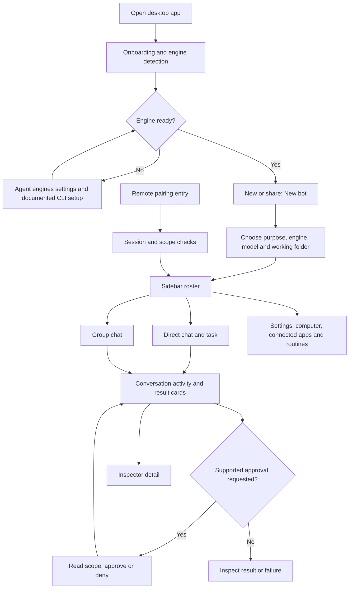

# Squadbots App Flow

Draft at base `2d6000337544c33d798347b3eb02b9969211b9ad`; describes source and existing documentation, not a live UI acceptance result.

## Entry points and journeys

The desktop shell composes onboarding, sidebar, direct chat, group chat, settings, computer and inspector surfaces in [src/App.tsx](../../src/App.tsx). These are UI surfaces, not invented browser routes. The public [quick tour](../../apps/docs/content/docs/getting-started/quick-tour.mdx) describes navigation between them.

1. **First bot:** onboarding detects engines; the user can refresh detection in App settings. Select New or share, then New bot, choose purpose, engine/model and working folder, then give a bounded first task. An engine requiring authentication is configured through that engine's CLI; this document does not authorize a login. Sources: [first-bot guide](../../apps/docs/content/docs/getting-started/first-bot.mdx), [WelcomeFlow](../../src/components/onboarding/WelcomeFlow.tsx), [NewBotDialog](../../src/components/NewBotDialog.tsx).
2. **Direct conversation:** select a bot in the sidebar and use its chat surface. Conversation/task state and messages are represented by `WireBot`, `WireTask` and `WireMessage`; canonical thread links identify a thread and optionally its owner. Sources: [App](../../src/App.tsx), [wire contracts](../../shared/wire.ts), [thread references](../../src/lib/thread-refs.ts).
3. **Approval and diagnosis:** when the engine supports approvals, read the requested action and scope in the conversation card, then approve or deny. Inspector provides tool, reconnect and engine activity detail. Authentication/configuration failures require resolving the underlying engine problem rather than repeatedly retrying. Source: [approvals and inspector guide](../../apps/docs/content/docs/features/approvals-and-inspector.mdx).
4. **Team and computer surfaces:** the shell has group chat, computer, connected-app, routine and settings surfaces. The quick tour describes entering these; their presence does not prove every integration is configured or available. Sources: [App](../../src/App.tsx), [quick tour](../../apps/docs/content/docs/getting-started/quick-tour.mdx).
5. **Remote entry:** the server handles `/pair`, `/api/auth/pair`, `/api/pair` and session routes. Local loopback trust and paired remote sessions have different checks; pairing is not an unconditional bypass. Sources: [server routing](../../server/index.ts), [request authentication](../../server/request-auth.ts), [sessions](../../server/sessions.ts).

## Flow diagram

This diagram summarizes the documented journeys and source-composed surfaces. Optional branches depend on engine capabilities and configuration; it is not a new product requirement.

## Evidence and limits

The offline [competitor teardown](CompetitorTeardown.md) keeps the first-task conversation loop as the ChatGPT comparison and roster/group ownership plus scoped approvals as the Grok Bot comparison. It does not replace this source-grounded flow with guessed competitor screens. Preserve honest lifecycle and recovery feedback; computer and connected-app branches remain capability-dependent. Competitive pricing, feature parity and reported gaps remain NEEDS-VERIFICATION.

[Verification README](../verification/README.md) requires isolated fixtures and explicit target URLs. Its chat UI and onboarding recipes are the existing paths for future acceptance; no app was launched for this draft. The current patch chain has local regression evidence, not screenshots or user-path acceptance. Remote membership, configured providers and actual engine readiness cannot be inferred from source presence. No real credentials or user data were read.
